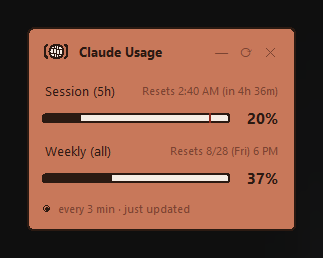

# Claude 사용량 위젯

Claude Code의 사용 한도 — 5시간 세션, 주간 전체, 모델별 주간 — 를 바탕화면에 상시 표시하는
작은 위젯. `/usage`를 매번 치지 않고도 남은 여유를 확인하려고 만들었다.

`/usage`가 읽는 것과 같은 데이터를 같은 기준(**사용한 %**)으로 표시한다.

[English →](README.md)



## ⚠️ 설치 전에 반드시 읽을 것

이 위젯은 Anthropic 공식 프로젝트가 아니고, 문서화된 API를 쓰지도 않는다.

1. **Claude Code 로그인 정보를 읽는다.** `~/.claude/.credentials.json`의 OAuth 토큰으로
   요청을 인증한다. 토큰을 출력하거나 로그·설정 파일에 남기지는 않는다.
2. **기본값으로는 그 파일에 쓰기도 한다.** accessToken이 만료(401)되면 재발급받아
   원자적으로 파일에 다시 저장한다. 그래서 PC를 껐다 켜도 Claude Code를 먼저 실행하지 않고
   바로 값이 뜬다. 이게 싫으면 `config.json`에 `"auto_refresh_token": false`를 넣으면 된다 —
   그러면 파일에 절대 쓰지 않고, 만료 시 "Claude Code를 한 번 실행하세요"로 폴백한다.
3. **두 엔드포인트 모두 비공식·비문서화다** — 값 조회는 `api.anthropic.com/api/oauth/usage`,
   토큰 재발급은 `console.anthropic.com/v1/oauth/token`. 예고 없이 바뀌거나 막힐 수 있고,
   본인 계정의 이용약관에 비추어 써도 되는지는 본인이 판단해야 한다.
4. **Windows 전용이다.** 아래 요구사항 참고.

이 중 하나라도 받아들이기 어렵다면 설치하지 말 것.

## 요구사항

- Windows (10 또는 11)
- tkinter가 포함된 Python 3.10+ — python.org 기본 설치본이면 된다
- 로그인된 Claude Code (Pro 또는 Max)

pip 의존성 없음. 표준 라이브러리만 쓰는 게 설계 원칙이다.

Windows에만 있는 것 세 가지에 기댄다: Tk의 `-transparentcolor` 속성, `msvcrt` 파일 락,
시작 프로그램 폴더. 다른 플랫폼에서는 크래시하는 대신 이유를 출력하고 종료한다.

## 설치와 실행

```bash
git clone https://github.com/HGK-lab/claude-usage-widget.git
cd claude-usage-widget
python main.py
```

콘솔창 없이 띄우려면 `run_widget.bat`을 더블클릭하거나 `pythonw main.py`.

`config.json`을 직접 만들 필요는 없다 — 기본값으로 뜨고, 창을 옮기거나 설정을 바꾸면
위젯이 알아서 파일을 쓴다. 미리 설정하고 싶으면 `config.example.json`을 복사해서 쓰면 된다.

**한 번에 하나만 뜬다.** 이미 실행 중일 때 다시 실행하면 새 창을 만들지 않고 조용히 종료한다.
작업 관리자로 강제 종료해 `.instance.lock` 파일이 남아도 괜찮다 — 다음 실행이 락을 그대로
회수한다. 문제를 고치겠다고 이 파일을 지우지 말 것.

## 사용법

| 조작 | 동작 |
|---|---|
| 카드 아무 곳이나 드래그 | 이동 (위치 자동 저장) |
| **—** | 세션 %만 보이는 작은 알약 배지로 축소. 배지를 클릭하면 복원 |
| **⟳** | 즉시 새로고침 |
| **✕** | 종료 |
| 우클릭 | 새로고침 · 최소화/복원 · 항상 위 · 시작 시 자동 실행 · 종료 |

바 색은 사용량 기준이다. 70% 미만은 잉크(다크브라운), 70~90%는 앰버, 90% 이상은 딥레드.

### 시작 시 자동 실행

우클릭 메뉴가 시작 프로그램 폴더에 `ClaudeUsageWidget.bat`을 만든다. 한글 경로가 깨지지
않도록 UTF-8(BOM 없이)로 저장하고 `chcp 65001`을 넣는다 — 손으로 고칠 일이 있으면 파일
인코딩과 `chcp` 줄을 반드시 짝 맞춰서 바꿀 것. 한쪽만 바꾸면 실행이 실패한다.

### 자동화 예약분 경고

`~/.claude/scheduled-tasks/`에 예약 작업이 있으면, 그 작업들이 쓸 여유를 남겨두도록
**세션 바에 빨간 제한선**을 그린다.

- 예약분 = (자동화 개수) × `automation_reserve_pct` (기본 1개당 5%, 상한 80%)
- 제한선 위치 = `100 − 예약분`%. 자동화를 추가·삭제하면 다음 갱신 때 선이 움직인다.
- 세션 사용량이 선을 넘으면 세션 %가 빨갛게 바뀌고 상태줄에 경고가 뜬다.

## 설정

`config.json`은 `main.py` 옆에 자동으로 생긴다. 모든 키가 선택 사항이고, 없거나 형식이
틀렸거나 범위를 벗어난 값은 위젯을 멈추는 대신 기본값으로 되돌린다.

| 키 | 기본값 | 의미 |
|---|---|---|
| `x`, `y` | `null` | 창 위치. 드래그하면 저장된다. `null`이면 화면 우상단 |
| `topmost` | `true` | 항상 위 |
| `minimized` | `false` | 알약 배지 상태로 시작 |
| `poll_interval` | `180` | 갱신 간격(초). **최소 180으로 강제** — 더 자주 부르면 429가 난다 |
| `automation_reserve_pct` | `5` | 예약 작업 1개당 남겨둘 세션 한도 % (0~100) |
| `language` | `"en"` | `"en"` 또는 `"ko"`. 모르는 값은 조용히 영어로 폴백 |
| `hidden_labels` | `[]` | 라벨에 이 문자열이 들어간 행을 숨긴다 (부분일치·대소문자 무시). 예: `["fable"]` |
| `auto_refresh_token` | `true` | 토큰 만료 시 재발급하고 `~/.claude/.credentials.json`에 쓸지 여부 |

한국어로 쓰려면 `config.json`에 `"language": "ko"`를 넣고 위젯을 다시 띄우면 된다.

## 동작 원리

`usage_api.py`가 OAuth 토큰을 읽어 `GET https://api.anthropic.com/api/oauth/usage`를 부르고,
응답을 한도 목록으로 정규화한다. `main.py`는 백그라운드 스레드에서 그걸 폴링해 큐를 통해
tkinter 메인 스레드로 넘긴다. `i18n.py`에 영어·한국어 문자열이 들어 있다.

알아둘 만한 것들:

- `poll_interval`초마다 `claude-code/2.0.0` User-Agent로 요청한다. 이 헤더가 없으면
  공격적인 rate-limit 버킷에 걸려 계속 429가 난다.
- 429가 나면 간격을 6분 → 12분 → 24분으로 늘렸다가 스스로 회복한다.
- 만료된 토큰을 재발급하기 **전에** credentials 파일을 다시 읽어 Claude Code가 이미
  갱신했는지 확인한다. 갱신됐으면 그 토큰으로 재요청만 한다 — 다시 재발급하면
  refreshToken이 회전해서 CLI가 로그아웃되기 때문이다.
- 응답 형식이 바뀌면 낡은 값을 보여주는 대신 상태줄에 **⚠ 데이터 형식 변경됨**이 뜬다.

## 문제 해결

**"로그인 정보 없음" / "토큰 만료"** — Claude Code를 한 번 실행해 토큰을 새로 쓰게 한 뒤
⟳를 누른다. `auto_refresh_token`을 껐다면 만료될 때마다 이 과정이 필요하다. 그게 그 설정의
대가다.

**`python main.py`를 쳐도 아무 일이 없다** — 이미 실행 중일 가능성이 높다. 설계상 조용히
종료한다. 작업 관리자에서 `pythonw.exe`를 확인할 것.

**"⚠ 데이터 형식 변경됨"** — 비공식 엔드포인트의 응답 형식이 바뀐 것이다. 본 내용을 담아
이슈를 남겨 달라. 위젯이 알아서 추측하게 두면 안 된다.

**시작 프로그램 `.bat`이 아무것도 안 한다** — 실제 콘솔 창에서 직접 실행해 오류를 확인한다.
`pythonw`는 콘솔이 없어서 경로가 틀려도 조용히 실패한다.

## 기여

`CLAUDE.md`에 아키텍처와 깨면 안 되는 불변조건이 정리돼 있다. 토큰·락 관련 코드를 건드리기
전에 반드시 읽을 것. `.claude/agents/`의 서브에이전트 정의도 함께 있다.

테스트 프레임워크는 없다. 검증은 `python -m py_compile main.py usage_api.py i18n.py` →
`python usage_api.py`로 실측값 출력 → 위젯을 띄워 `/usage`와 대조하는 순서로 한다.

## 라이선스

MIT — [LICENSE](LICENSE) 참고.
