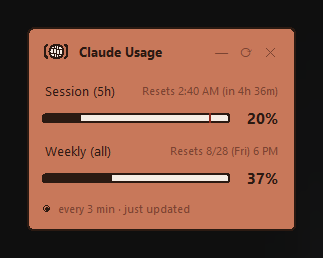

# Claude Usage Widget

A small always-on-top desktop widget that shows your Claude Code usage limits — the
5-hour session window, the weekly total, and any per-model weekly limits — so you don't
have to type `/usage` to find out how much room you have left.

It reads the same numbers `/usage` reads and reports them the same way: **percent used**.

[한국어 문서 →](README.ko.md)



## ⚠️ Read this before you install

This widget is not an official Anthropic project, and it does not use a documented API.

1. **It reads your Claude Code credentials.** The OAuth token in
   `~/.claude/.credentials.json` is what authenticates every request. The widget never
   prints, logs, or stores that token anywhere else.
2. **By default it also writes to that file.** When the access token expires (HTTP 401),
   the widget refreshes it and saves the new token back atomically, so the widget keeps
   working after a reboot without you launching Claude Code first. Set
   `"auto_refresh_token": false` in `config.json` to disable this — the widget then falls
   back to asking you to run Claude Code once, and never writes to the file.
3. **Both endpoints are unofficial and undocumented** —
   `api.anthropic.com/api/oauth/usage` for the numbers and
   `console.anthropic.com/v1/oauth/token` for the refresh. They can change or stop
   working without notice, and you are responsible for deciding whether using them is
   consistent with Anthropic's terms for your account.
4. **Windows only.** See Requirements.

If any of that is not acceptable to you, don't install it.

## Requirements

- Windows (10 or 11)
- Python 3.10+ with tkinter — the standard python.org installer includes it
- Claude Code, logged in (Pro or Max)

No pip dependencies. The standard library only, on purpose.

The widget depends on three Windows-specific things: the Tk `-transparentcolor` window
attribute, the `msvcrt` file lock, and the Startup folder. On any other platform it
prints why and exits instead of crashing.

## Install and run

```bash
git clone https://github.com/HGK-lab/claude-usage-widget.git
cd claude-usage-widget
python main.py
```

To run it without a console window, double-click `run_widget.bat` (or use
`pythonw main.py`).

You do not need to create a `config.json` — the widget starts with its defaults and
writes the file itself when you move the window or change a setting.
`config.example.json` is there if you want to set something up front.

**Only one window opens.** Launching the widget while it is already running exits
silently instead of opening a second card. If you kill it from Task Manager the
`.instance.lock` file stays behind — that is fine, the next launch reclaims the lock.
Never delete it to "fix" anything.

## Using it

| Action | What it does |
|---|---|
| Drag anywhere on the card | Move it. The position is saved. |
| **≡** | Open the menu (same as right-click) |
| **—** | Shrink to a small pill badge showing the session and weekly percentages. Click the pill to restore. |
| **⟳** | Refresh now |
| **✕** | Quit |
| Right-click | Refresh · Minimize/restore · Always on top · Run at startup · Dark theme · Quit |

**Reading a row.** The blocks are *time*: one per hour for the 5-hour session, one per
day for the week. Blocks fill in as time passes and the outlined block is now. The thin
bar over them is *usage*. If the bar runs ahead of the filled blocks, you are spending
faster than the window is passing.

- 70% and above: an "over 70%" tag appears and the bar turns a deeper clay.
- 90% and above, or past the automation line: the whole card flips (dark card in the
  light theme, light card in the dark theme).
- The weekly row shows a daily budget: what is left, split over the days left.
- If a refresh fails, the last values stay on the card, dimmed, with how old they are.

The colors are Claude's clay, ivory and slate. Switch to the dark theme from the menu.

### Run at startup

The right-click menu writes `ClaudeUsageWidget.bat` into your Startup folder. The file is
UTF-8 without a BOM and starts with `chcp 65001`, which is what keeps non-ASCII paths from
breaking — if you edit it, keep the encoding and the `chcp` line in sync.

### Automation headroom

If you have scheduled tasks in `~/.claude/scheduled-tasks/`, the widget draws a red limit
line across the session blocks so you can see whether you are about to spend the room those tasks
will need.

- Reserved = (number of automations) × `automation_reserve_pct` (default 5% each, capped
  at 80%).
- The line sits at `100 − reserved`%. Add or remove an automation and the line moves on
  the next refresh.
- Cross it and the session row is tagged "into reserve", the card flips, and the status
  line says how much you are into the reserve.

## Configuration

`config.json` lives next to `main.py` and is written automatically. Every key is optional;
anything missing, malformed, or out of range falls back to the default rather than
stopping the widget from opening.

| Key | Default | Meaning |
|---|---|---|
| `x`, `y` | `null` | Window position. Saved when you drag it. `null` = top-right of the screen. |
| `topmost` | `true` | Keep the card above other windows |
| `minimized` | `false` | Start as the pill badge |
| `poll_interval` | `180` | Seconds between refreshes. **Clamped to a minimum of 180** — polling faster triggers HTTP 429. |
| `automation_reserve_pct` | `5` | Session percentage to reserve per scheduled automation (0–100) |
| `language` | `"en"` | `"en"` or `"ko"`. Anything else silently falls back to English. |
| `hidden_labels` | `[]` | Hide any row whose label contains one of these strings (case-insensitive). E.g. `["fable"]`. |
| `auto_refresh_token` | `true` | Whether to refresh the OAuth token — and write `~/.claude/.credentials.json` — when it expires |
| `theme` | `"light"` | `"light"` or `"dark"`. Anything else falls back to light. |

## How it works

`usage_api.py` reads the OAuth token, calls
`GET https://api.anthropic.com/api/oauth/usage`, and normalizes the response into a plain
list of limits. `main.py` polls it on a background thread and pushes results to the tkinter
main thread through a queue. `i18n.py` holds the English and Korean strings, and
`theme.py` the colors, fonts and sizes (see `DESIGN.md`).

A few details worth knowing:

- Requests are sent every `poll_interval` seconds with the `claude-code/2.0.0` user agent.
  Without that header the endpoint rate-limits aggressively.
- On HTTP 429 the widget backs off — 6, then 12, then 24 minutes — and recovers on its own.
- Before refreshing an expired token, the widget re-reads the credentials file to see
  whether Claude Code already refreshed it. If so it just retries with the newer token,
  because refreshing again would rotate the refresh token and log the CLI out.
- If the response shape ever changes, the status line says **⚠ Response format changed**
  rather than showing stale numbers.

## Troubleshooting

**"Not signed in" / "Token expired"** — run Claude Code once so it writes a fresh token,
then hit ⟳. If you turned `auto_refresh_token` off, expect to do this whenever the token
expires; that is the trade.

**Nothing happens when I run `python main.py`** — the widget is probably already running.
It exits silently by design. Check your notification area and the task manager for
`pythonw.exe`.

**"⚠ Response format changed"** — the unofficial endpoint changed shape. Please open an
issue with what you see; do not expect the widget to guess.

**The startup `.bat` does nothing** — run it from a real console window to see the error.
`pythonw` has no console, so a bad path fails silently.

## Contributing

`CLAUDE.md` documents the architecture and the invariants that must not be broken — read
it before changing anything in the token or locking paths. It and the subagent definitions
in `.claude/agents/` are written in Korean.

There is no test framework. Verification means running
`python -m py_compile main.py usage_api.py i18n.py theme.py`, then
`python usage_api.py` to print live values, then opening the widget and comparing against
`/usage`.

## License

MIT — see [LICENSE](LICENSE).
